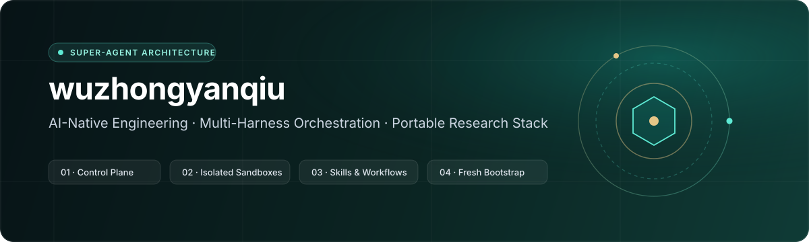

 

## Super-Agent · 从多工具协同到主动判断

> *Task diversity grounds competence. Taste may unlock generalization.*  
> 多样任务数据建立智能的能力底座；下一次值得期待的涌现，发生在**审美与结构判断**。

我关注并构建一套面向真实工程与科研场景的 **Super-Agent 系统**：把多模型 Harness、隔离沙箱、可复用 Skill、自动化工作流与实时运行态观测统一到一个控制面中，让 Agent 不仅能执行指令，更能在开放任务中完成结构取舍、质量核验与持续迭代。

---

### 01 · 系统架构与开源矩阵

| 维度 | 代表项目 | 核心能力 |
| :--- | :--- | :--- |
| **Control Plane** | [`advanced-research-control`](https://github.com/wuzhongyanqiu/advanced-research-control) | 多仓库协同与运维总控台：Git 同步调度、多 Harness 调用与 Token 观测、资源检索与实时健康看板 |
| **Multi-Agent Sandbox** | [`DS-Bot`](https://github.com/wuzhongyanqiu/DS-Bot) | 多 Bot 协作与硬隔离实验空间：支持密码域隔离、受控工具授权、跨 Bot 群聊与自主人设演化 |
| **Creator & Media** | [`open-creator-toolbox`](https://github.com/wuzhongyanqiu/open-creator-toolbox) · [`ai-video-kit`](https://github.com/wuzhongyanqiu/ai-video-kit) | 音视频抽帧与字幕提取、多模态素材生成与视觉审图闭环、3D 资产清理与自动化宣发管线 |
| **Research Radar** | [`llm-landscape`](https://github.com/wuzhongyanqiu/llm-landscape) · [`dsh-ecosystem-dashboard`](https://github.com/wuzhongyanqiu/dsh-ecosystem-dashboard) | 前沿模型能力雷达、Harness 生态观测与自动化研究追踪 |

---

### 02 · Engineering Thesis · 为什么这样设计

1. **控制面与执行面解耦** — 统一的资源索引与运行态观测，让不同模型与 Harness（Codex、Claude Code、DSH、Antigravity）在同一套工程规范下协同，而不是各自为战。
2. **硬边界隔离与可控自治** — 沙箱边界由底层工具守卫而非提示词约束保证，既允许实验性 Agent 在受控空间内自由协作，又确保核心工作区与凭据零越界。
3. **审美作为跨任务泛化信号** — 用“结构清晰、低冗余、上下文适切性”约束代码架构、界面呈现与内容生成，使系统从“做完”走向“做好”。

---

  Super-Agent Stack · <a href="https://github.com/wuzhongyanqiu/advanced-research-control">Control Plane</a> · Agent bootstrap: <code>npm run bootstrap</code> in <code>sync-controller</code>

