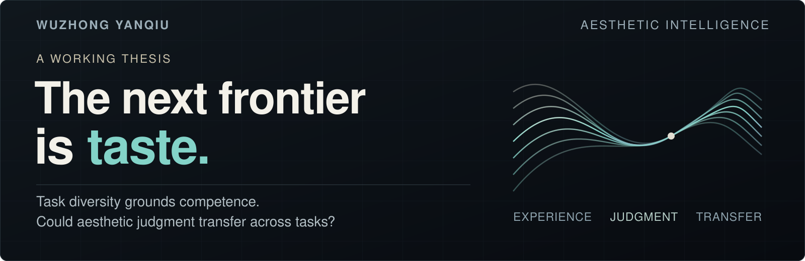

## Aesthetic intelligence · 审美与泛化

我关注一个假说：**多样任务数据建立智能的能力底座，下一次值得期待的涌现，可能发生在审美。**

> *Task diversity grounds competence. Taste may unlock generalization.*

### 01 任务经验决定下限，下一步是形成判断

训练与 Agent 的能力下限，应当扎根于足够广泛的任务数据、真实交互与结果反馈。模型需要先学会理解约束、调用工具、完成任务，并从失败中修正。

在这个底座之上，我更关心另一种能力：当指令没有穷尽标准、答案不止一个时，系统能否主动辨别什么更好，并据此取舍。

### 02 审美，是对整体质量的感知

我所说的审美，包含对**结构、简洁、比例、连贯与情境适切性**的判断：局部都成立，整体是否仍然失衡？信息已经充分，表达是否还在制造噪声？一个方案足够复杂，是否也足够必要？

这种判断的价值，在于它有机会进入生成过程：系统能够察觉不协调，比较候选方案，知道该保留什么、删去什么，以及什么时候值得重做。

### 03 真正值得期待的，是审美向其他任务迁移

我的猜想是，不同任务的优质解法，可能共享某些结构：用更少的冗余组织更多信息，让局部选择服从整体目标，在约束之间形成恰当的平衡。

如果模型学到的是这些关系，审美判断就可能越过表面风格：从构图与叙事，迁移到**代码架构的清晰、推理表达的紧凑、研究问题的选择，以及 Agent 对目标与路径的取舍**。

这也是我理解的下一次涌现：系统在新的任务中，开始表现出没有被逐项写进指令的质量判断。

## The bet · 我对下一阶段的判断

**任务训练让系统知道怎么做，审美能力可能让它更善于判断什么值得做、怎样做得更好。** 我期待的变化，是从完成指令，走向理解质量；从生成候选，走向主动选择与自我修正。

这个假说需要跨任务证据：在控制训练数据量、算力与反馈预算后，审美或偏好训练的收益，应当能够迁移到**不共享表面风格的未见任务**，并体现在独立的任务指标上。

如果提升只停留在视觉风格、评审者偏好或相似题型，它就还不能被称为通用能力的增长。审美也不能替代事实核验、逻辑与功能验证——值得研究的是它能否与这些能力协同，而非以美代真。

这是我的研究兴趣与个人预测。真正的说服力，应来自能够被复现、也能够被推翻的结果。
